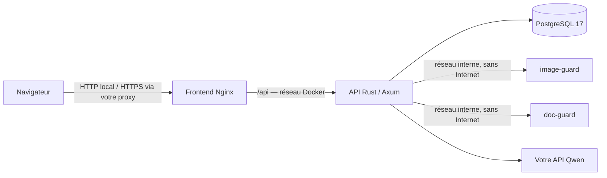

# L’Observatoire

Chatbot Qwen avec une interface React sobre, un backend Rust et des conversations privées enregistrées dans PostgreSQL.

## Architecture



| Service | Rôle | Accès depuis l’hôte |
| --- | --- | --- |
| `frontend` | Application React/TypeScript compilée avec Vite, servie par Nginx et proxy de l’API | `127.0.0.1:8080` par défaut |
| `backend` | Rust, Axum, SQLx : authentification, conversations, streaming Qwen | Aucun port publié |
| `db` | PostgreSQL, sur un réseau Docker interne | Aucun port publié |
| `image-guard` | Seul service qui décode les images envoyées : vérifie et réencode, sans réseau sortant ni données | Aucun port publié |
| `doc-guard` | Seul service qui ouvre les documents envoyés (PDF, Word, texte) : extrait le texte et rend les pages en image, sans réseau sortant ni données | Aucun port publié |

Les images frontend et backend sont distinctes. Le frontend est compilé dans une étape Node 24 ; le conteneur final contient uniquement Nginx et les fichiers statiques, sans serveur Node. Les polices et bibliothèques du navigateur sont embarquées : aucun CDN n’est requis. Le frontend et l’API utilisent la même origine via Nginx.

## Démarrage

Prérequis : Docker avec le plugin Compose (2.24.4+ pour les tests), Python 3 pour les utilitaires et Make. Rust et Node ne sont pas nécessaires sur l’hôte.

```sh
git clone https://github.com/El-cmd/L-Observatoire.git chatbot_perso
cd chatbot_perso
make init
```

Renseigner `QWEN_BASE_URL` (adresse terminée par `/v1`) et `QWEN_API_KEY` dans `.env`, puis :

```sh
make up
make user
```

`make user` demande un identifiant et un mot de passe masqué de 12 caractères minimum. Le premier compte devient administrateur ; les suivants sont des comptes ordinaires. Il n’existe pas d’inscription publique. La création et la réinitialisation des comptes demandent un accès opérateur au serveur Docker.

Autre possibilité pour le tout premier compte : `make first-user` génère un mot de passe aléatoire et le place dans `.initial-admin-password` (permissions 600, exclu de Git). Ne pas partager ce fichier ; le supprimer après avoir conservé le mot de passe dans un gestionnaire.

Ouvrir **http://localhost:8080** et se connecter. Les conversations sont enregistrées en base et isolées par compte. Le menu de compte en bas de la barre latérale permet de changer son mot de passe ou de se déconnecter.

## Authentification et accès

- Mots de passe hachés avec Argon2id, sel aléatoire distinct par mot de passe.
- Sessions opaques de 256 bits ; seul le SHA-256 du jeton est enregistré en base. Aucun jeton d’authentification dans `localStorage`.
- Cookie `HttpOnly`, `SameSite=Lax`, durée maximale de 24 heures. `Secure` et préfixe `__Host-` lorsque `PUBLIC_ORIGIN` utilise HTTPS.
- Nouvelle session à chaque connexion ; déconnexion révoquée en base. Un changement ou une réinitialisation du mot de passe révoque toutes les sessions du compte.
- Vérification stricte de `Origin` et jeton CSRF sur les écritures authentifiées. Le jeton CSRF reste dans la mémoire de la page.
- Tentatives de connexion limitées en PostgreSQL par identifiant et par adresse IP, plus une limite Nginx. Les compteurs persistent après redémarrage.
- Toute lecture, modification, suppression ou génération vérifie le propriétaire de la conversation. L’API renvoie 404 pour une conversation appartenant à un autre compte.
- Concurrence limitée pour le hachage des mots de passe et les générations. Mises à jour des conversations avec vérification de version pour éviter les écrasements entre onglets.

Le rôle SQL de l’API n’est pas superutilisateur et ne peut créer ni base ni rôle. Il possède son schéma applicatif pour exécuter les migrations. Le mot de passe de l’administrateur PostgreSQL est séparé et n’est pas transmis au backend.

## Configuration

| Variable | Usage |
| --- | --- |
| `PORT` | Port local du frontend, `8080` par défaut |
| `PUBLIC_ORIGIN` | Origine exacte du site, sans chemin : `http://localhost:8080` ou `https://chat.exemple.fr` |
| `QWEN_BASE_URL` | Base de l’API compatible, terminée par `/v1` |
| `QWEN_API_KEY` | Clé envoyée uniquement par l’API Rust à Qwen |
| `QWEN_MODEL` | `qwen3.8-27b-abliterated` par défaut |
| `POSTGRES_PASSWORD` | Mot de passe du rôle applicatif, généré par `make init` |
| `POSTGRES_ADMIN_PASSWORD` | Mot de passe de l’administrateur PostgreSQL, généré séparément |
| `BOOTSTRAP_USERNAME`, `BOOTSTRAP_PASSWORD` | Facultatifs : création du premier administrateur uniquement si aucun utilisateur n’existe |

`make init` conserve les valeurs existantes et crée les secrets PostgreSQL manquants. `.env` reste local, avec permissions 600, et est exclu de Git et des images. Ne pas modifier les mots de passe PostgreSQL dans `.env` après création du volume sans modifier aussi les rôles dans la base. Les secrets générés utilisent un alphabet compatible avec les URL PostgreSQL.

Après un changement de configuration, utiliser `make restart` pour recréer les conteneurs. Un simple `docker compose restart` ne recharge pas les variables d’environnement.

Pour un accès hors de la machine, placer le frontend derrière un proxy HTTPS et définir `PUBLIC_ORIGIN` avec l’adresse HTTPS exacte. Les ports API et PostgreSQL doivent rester privés. La configuration fournie conserve l’écoute sur `127.0.0.1`.

## Interface et conversations

- Conversations dans la barre latérale ; copie des questions et réponses.
- Titre court donné par Qwen à partir de la première question, pendant la réponse ; renommage avec le crayon ou un double-clic (un titre choisi n’est plus remplacé). Au démarrage, l’API nomme les conversations encore intitulées d’après leur question.
- Plusieurs conversations peuvent écrire en même temps (six générations au total sur le serveur).
- Réponses en streaming ; arrêt et nouvelle génération.
- Réponses jusqu’à 32 768 tokens, dans la place laissée par la conversation ; les anciens échanges ne sont résumés que s’il reste moins de 8 192 tokens pour répondre. Une réponse coupée par la limite se poursuit dans le même message avec **Continuer**.
- Réglage de température et réflexion (`none`, `low`, `medium`, `xhigh`). Réglages mémorisés dans ce navigateur, séparément pour chaque compte.
- Coloration syntaxique, numéros de ligne, copie du code sans les numéros.
- Rendu LaTeX : `$…$`, `$$…$$`, `\(…\)` et `\[…\]`.
- HTML du modèle échappé ; commandes KaTeX de confiance désactivées.

L’API lit l’historique en base pour construire les requêtes Qwen. Le raisonnement n’est pas réinjecté dans le contexte. Le backend sauvegarde la réponse avant de signaler la fin au navigateur et conserve la partie reçue lors d’une interruption. Le contexte et les quotas du serveur Qwen restent applicables. L’interface est limitée au texte.

## Images et bibliothèque

Le bouton **+** de la saisie ajoute des images depuis l’ordinateur ou depuis la bibliothèque ; le glisser-déposer et le collage d’une capture fonctionnent aussi. Cinq images au plus par message. Formats : JPEG, PNG, WebP, GIF (première image), AVIF et BMP, plus HEIC et TIFF depuis Safari ; SVG refusé.

- Le navigateur réduit l’image à 1 600 px de côté et la réencode : les métadonnées (position GPS comprise) ne quittent pas l’appareil.
- Côté serveur, l’API ne décode jamais un fichier reçu : elle le transmet à **image-guard**, conteneur sans réseau sortant (réseau Docker `guard` interne), sans base, secrets ni volume, en lecture seule, non root, sans capacités, limité en mémoire, CPU et processus. Il vérifie le format réel (PNG, JPEG, WebP, GIF, décodeurs en Rust pur), refuse les bombes de décompression, réencode depuis les pixels et renvoie l’image propre et sa miniature. Une image qui bloquerait le décodeur fait redémarrer le conteneur.
- Seule la copie nettoyée est stockée (PostgreSQL), affichée et envoyée à Qwen. Elle appartient à la **bibliothèque** du compte (500 Mo) : la même image n’est stockée qu’une fois, elle survit à la suppression d’une conversation, et sa suppression la remplace par « Image supprimée » dans les messages.
- Qwen lit les images lui-même (modèle multimodal). Elles restent envoyées telles quelles tant que la conversation tient dans le contexte : une image coûte un token par carré de 32 px (environ 1 900 pour 1 600 × 1 200). Quand le contexte est plein, Qwen transcrit une fois les images des messages résumés ; la transcription sert au résumé.

## Documents

Le même bouton **+** ajoute des documents : PDF (60 pages au plus), Word `.docx` et fichiers texte (texte, Markdown, CSV, JSON, code), 20 Mo au plus. Excel, PowerPoint et les anciens formats sont refusés avec un message (« enregistre-le en PDF »).

- L’API n’ouvre jamais un document : **doc-guard** (Python, réseau Docker `docs` interne, sans base, secrets ni volume, lecture seule, non root, limité en mémoire, CPU et processus) ouvre chaque document dans un processus à part, plafonné en mémoire et en temps. Il utilise le lecteur PDF de Docling **sans ses modèles** (pas de PyTorch), pdfium pour rendre les pages, MarkItDown pour Word.
- Un PDF est lu **une seule fois**, au dépôt, page par page, 4 pages à la fois, avec Qwen :
  - une page dont le texte est fiable est **annotée** : Qwen voit son image et ses morceaux de texte numérotés et ne renvoie que la structure (titres, paragraphes, listes, tableaux) ; le Markdown est assemblé avec le texte du PDF, donc aucun mot ni chiffre ne peut être modifié. Si la structure est incohérente, la page garde son texte brut ;
  - une page **scannée** est lue sur son image à 2 400 px : page sans texte, texte invisible ajouté par un scanner sous une image pleine page, ou texte illisible (police mal encodée). Qwen marque d’un `[?]` les lectures incertaines, notamment l’écriture à la main.
- Le Markdown est gardé dans la bibliothèque et envoyé à Qwen avec les questions, une fois par conversation. Un document de plus de 39 300 tokens (30 % du contexte) est refusé. Le texte lu est visible en cliquant sur le document ; le fichier d’origine reste téléchargeable.
- Une lecture interrompue par un redémarrage de l’API est marquée en échec : il suffit de renvoyer le document.

## Migration de l’ancienne version

`make up` remplace l’ancien service Python `chat` par les trois nouveaux services. Les anciennes conversations restent dans le stockage du navigateur : elles ne sont pas automatiquement affectées à un utilisateur.

Après connexion, le menu de compte propose **Importer les anciens chats de ce navigateur** lorsqu’un ancien historique est présent. N’importer que ses propres conversations, sur le compte choisi. L’import est transactionnel et limité à 100 conversations et 512 Ko par requête. Le stockage local original est conservé.

Les anciennes variables `CHAT_USER` / `CHAT_PASSWORD` de l’authentification Basic ne sont plus utilisées. Créer un compte avec `make user`. La nouvelle authentification ne partage aucun mot de passe avec le VPS ou GitHub.

## Administration et sauvegardes

```sh
make user             # Créer un compte
make reset-password   # Changer un mot de passe perdu et révoquer ses sessions
make backup           # Dump PostgreSQL dans backups/, permissions 600
make status
make logs
make down             # Arrêter sans supprimer le volume
```

Le volume nommé `postgres_data` conserve les comptes, sessions et conversations après arrêt ou recréation des conteneurs. Les sauvegardes contiennent des données privées : elles sont exclues de Git, à conserver aussi hors de cette machine.

Restauration à effectuer dans une base vide après vérification de la sauvegarde et arrêt des écritures. Exemple avec une base de restauration préalablement créée :

```sh
docker compose exec -T db pg_restore --no-owner --no-privileges \
  -U observatoire_owner -d NOM_BASE_VIDE < backups/observatoire-AAAAMMJJ-HHMMSS.dump
```

Ne pas lancer `docker compose down -v` sur l’installation courante : cette option efface le volume. Le Makefile ne l’utilise pas.

## Déploiement sur le VPS

En production, le service tourne sur le VPS derrière Nginx Proxy Manager (NPM), à l’adresse **https://observatoire.vloth.tech**. `compose.prod.yaml` retire le port publié du frontend et le branche sur le réseau Docker `proxy-network` sous le nom `observatoire` : dans NPM, l’hôte redirige vers `http://observatoire:8080`. Le `.env` du serveur contient :

```sh
COMPOSE_FILE=compose.yaml:compose.prod.yaml
PUBLIC_ORIGIN=https://observatoire.vloth.tech
```

Ainsi `make up`, `make user`, `make backup` et `make logs` utilisent la configuration de production sans option supplémentaire.

Chaque push sur `main` lance les tests ; s’ils passent, le workflow **Déploiement** se connecte en SSH au VPS et exécute `scripts/deploy.sh <sha>`. Le script vérifie que le commit appartient à `main`, sauvegarde PostgreSQL (seules les 7 dernières sauvegardes sont gardées), puis reconstruit et redémarre les conteneurs en attendant qu’ils soient sains. Le workflow peut aussi être lancé à la main depuis l’onglet Actions.

La clé SSH de déploiement est dédiée et limitée à ce script par une commande forcée dans `~/.ssh/authorized_keys` du serveur :

```
command="/home/vloth/prod/apps/observatoire/scripts/deploy.sh",no-port-forwarding,no-agent-forwarding,no-X11-forwarding,no-pty ssh-ed25519 AAAA… github-deploy-observatoire
```

Secrets GitHub (Settings → Secrets and variables → Actions) : `VPS_SSH_KEY` (clé privée), `VPS_KNOWN_HOSTS` (sortie de `ssh-keyscan -p <port> <hôte>`), `VPS_HOST` (`vloth@<adresse>`) et `VPS_PORT`. L’adresse du VPS reste hors du dépôt public pour ne pas contourner Cloudflare.

Le Nginx du frontend reprend l’adresse réelle du visiteur depuis `X-Forwarded-For` lorsque la requête vient d’un réseau Docker ou de Cloudflare, et transmet `X-Accel-Buffering: no` à NPM pour que le streaming ne soit pas retenu.

## Développement du frontend React

Les composants sont dans `frontend/src/components/`, la gestion des conversations et sessions dans `frontend/src/hooks/useObservatoire.ts`, et le client API, le streaming et le rendu dans `frontend/src/lib/`. Les messages sont gérés par React ; les blocs de code conservent leurs numéros de ligne et les formules utilisent KaTeX.

Pour le développement hors Docker, installer Node 24 puis :

```sh
cd frontend
npm ci
npm run check
npm run test
npm run dev
```

Vite écoute sur `http://localhost:5173` et relaie `/api` vers `http://localhost:8080`. Pour ce mode de développement, définir temporairement `PUBLIC_ORIGIN=http://localhost:5173` dans `.env` et recréer l’API avec `make restart` depuis la racine. Revenir à l’origine de production après le développement. Les protections CSRF restent actives et aucun secret Qwen n’est transmis à Vite.

`npm run build` vérifie TypeScript puis produit `frontend/dist/`. Les versions exactes des dépendances sont conservées dans `frontend/package-lock.json` et Docker installe avec `npm ci`.

## Tests

```sh
make build
make test
```

La construction du frontend exécute les tests Vitest (stream SSE, UTF-8, LaTeX et échappement du HTML), le contrôle TypeScript et la compilation Vite. Les tests Rust couvrent les identifiants, la politique de mots de passe, Argon2id et les paramètres Qwen. Les tests d’intégration démarrent un projet Docker séparé avec une base jetable et une API Qwen simulée, sans utiliser les secrets de votre `.env` ni consommer de tokens.

Ils vérifient les accès anonymes, les cookies et jetons hachés, le rôle SQL, les protections Origin/CSRF, l’isolation des comptes, les conflits de version, le streaming et l’annulation, la révocation et l’expiration des sessions, les limites de connexion, la persistance après redémarrage et la restauration d’un dump. Seul le volume du projet de test est supprimé à la fin.

Des parcours navigateur sont disponibles dans `tests/browser.mjs` avec Playwright : `OBSERVATOIRE_BROWSER=1 python3 tests/integration/run.py` après installation locale de Playwright et de son navigateur. Le backend de test utilise une API simulée.

Cette configuration prévoit une seule instance de l’API : les verrous de génération sont récupérés au redémarrage. Pour plusieurs réplicas, remplacer cette récupération par une coordination distribuée avec renouvellement des baux.
